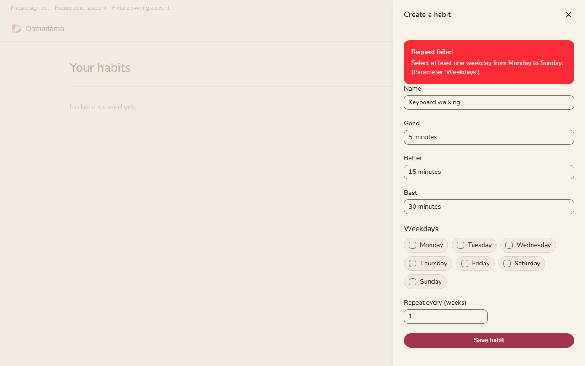
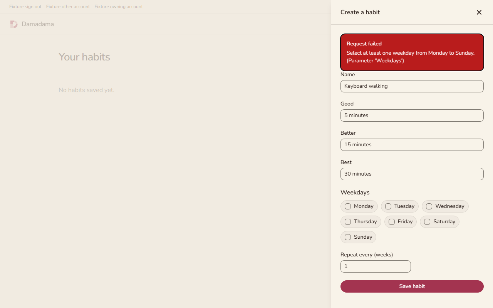
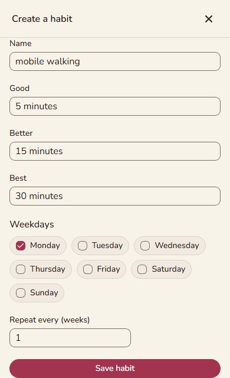
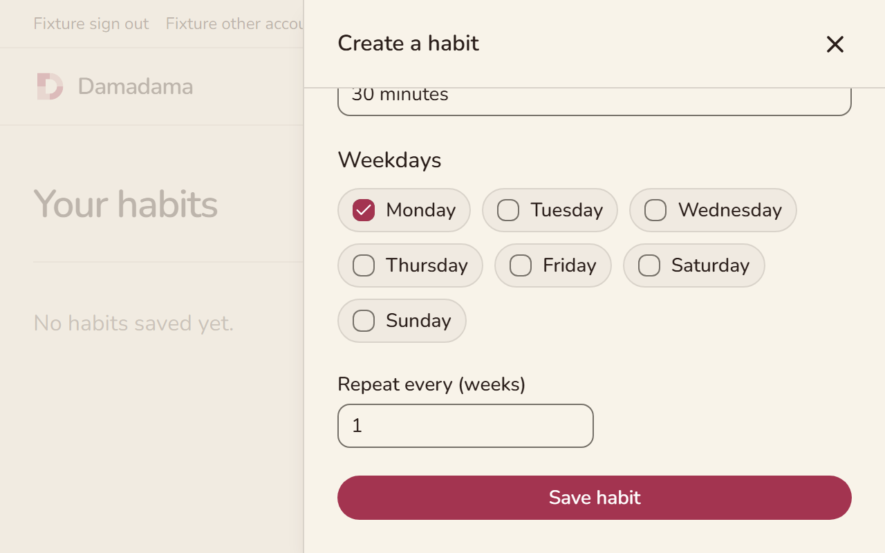

# Browser accessibility gate evidence

This layer builds on performance PR22 at `22a5a89a2e4293665eed6334a668da441e58c623`. The application dependency remains PR11 at `9c8437e1e4a46965513b53f60d7fa569c0fd18ea`. Review and land those layers in that order before this one.

The [complete local check](accessibility-full-check.log) passed five performance CLI controls, 18 browser tests, and 51 backend tests with exit code zero. It includes lint, formatting, locked restores, type checking, both optimized frontend builds, and the inherited performance gates. The resulting production assets total 313307 gzip bytes in seven files, within the existing budgets. No speed improvement is claimed.

The local receipts were produced before committing, so their `sourceRevision` is the performance parent. The [correctness review](accessibility-security-review.md) pins the canonical blobs of all nine implementation files. The [maintainability review](accessibility-quality-review.md) and its [details](accessibility-quality-review-details.md) pin the reviewed file hashes. Publication adds these receipts and normalizes line endings without changing the reviewed executable content. Both independent reviews found no material issue. The separate comment review required zero deletions and found no suppressions.

## Controls and observed fixes

The [initial unnamed-button control](accessibility-red.log) failed with actual `button-name` against an expected empty violation list. The permanent test inserts that real DOM defect, checks its [rule and selector](accessibility-control-missing-name.json), proves the same gate rejects it, removes it, and [passes the repaired page](accessibility-control-repaired.json).

The [first browser run](accessibility-first.log) found real contrast violations in the [configuration warning](accessibility-before-application-configuration.json), [validation refusal](accessibility-before-validation-refusal.json), and [expired-session error](accessibility-before-expired-session.json). The warning and error semantic colors now use `#92400e` and `#b91c1c`. The [configuration](accessibility-application-configuration.json), [refusal](accessibility-validation-refusal.json), and [expired-session](accessibility-expired-session.json) scans now report zero violations.

The [focus regression log](accessibility-focus-debug.log) and [focus observations](accessibility-focus-debug.json) show focus on BODY after a rejected save. The next Tab left the document. Save had been disabled during the request, and the dialog dependency did not recover focus from that disabled control. The component now focuses the rendered error alert after checking that the request still belongs to the current account and the panel remains open. The final keyboard test asserts that focus, tabs through every retry control, corrects the missing weekday, observes real 201 creation, and verifies persisted content after a real 200 reload. It uses no programmatic focus or mouse shortcut.

An intervening test attempt failed because Docker was unavailable. That infrastructure failure is not included as regression proof. Docker was restored before the final full check.

## Screenshots

The desktop viewport is 1280 by 800. The refusal alert has a darker background and receives a visible focus outline. Its message and form layout stay the same.

The mobile viewport is 390 by 640. Save remains reachable and fully visible after scrolling, and the page has no horizontal overflow.

The zoom case uses CSS zoom of 2 at 1280 by 800.

## Screen recording

[Keyboard creation, real API refusal, correction, save, and persistence](keyboard-refusal-retry.webm).

## Runtime verification and limitations

The full check ran on Windows with bundled Node 24, Bun 1.3.14, .NET 10, Docker 28.3.2, Playwright 1.64.0, and its pinned Chromium. It built the actual application and optimized browser fixture. The production-entry audit fetches the real configuration endpoint and sets only its public publishable key to null. The habit fixture mounts the actual HabitsPage and exercises the actual API through normal JWT middleware with ephemeral RSA tokens and PostgreSQL. Actual response assertions cover 400 refusal, 201 creation, 200 reload, and expired-token 401.

Positive scans report zero violations. Dialog scans retain an incomplete `aria-hidden-focus` result; this is not counted as a passed rule. Explicit keyboard assertions provide separate focus-containment evidence. Reports omit raw DOM markup, request and response bodies, headers, and tokens. Traces remain off. CI retains failure reports for three days.

These checks do not establish full WCAG compliance. Live Clerk sign-in, sign-up, account menus and email delivery were not exercised. Screen-reader speech, native browser zoom and assistive-technology interoperability still need manual review. CSS zoom is a repeatable layout check. See the [scanner and keyboard documentation](../../../docs/browser-accessibility.md).
