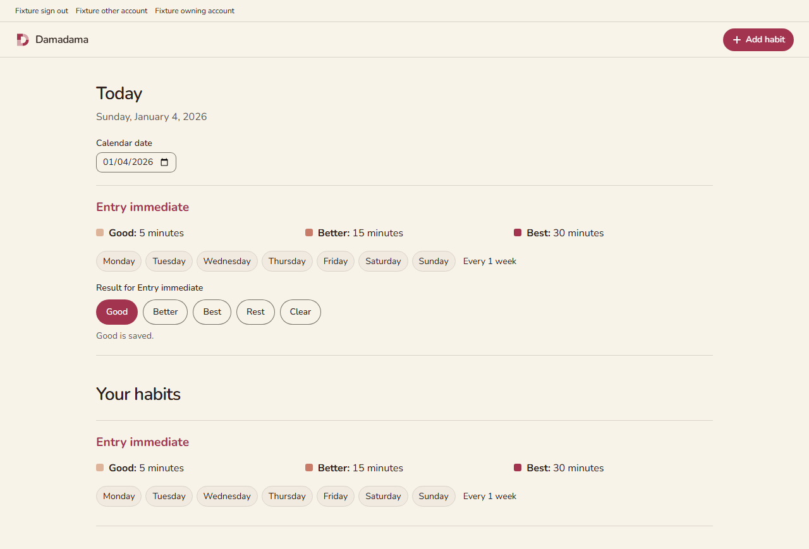
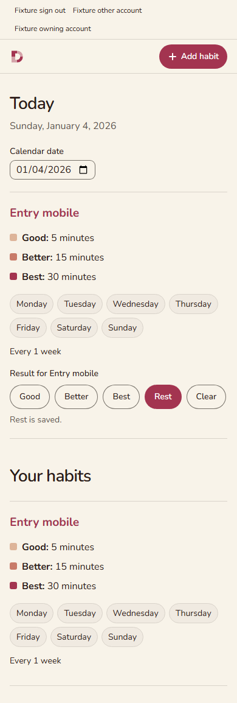

# Online entries

The canonical `bun run check` exited 0 at source revision
`5acb73c57f117502d73e28458a849b1b9c71f8ff`: **48 browser tests and 171 backend
tests passed**. This evidence commit changes no application or test source.

The branch is stacked on [Today PR #31](https://github.com/ShiosOS/Damadama/pull/31)
at `f0d622c5535f4dd3d59d03bed3da5a63323d6b48`. Both PRs remain subject to human
review and merge. The entry layer calls Today's existing
`ScheduleEligibility.IsScheduled(InitialSchedule, DateOnly)`.

## Reproduce

Use Node 24, Bun 1.3.14, .NET SDK 10.0.113 and a running Docker engine. The recorded
Windows run used Node 24.19.0 and Docker 28.3.2. From the repository root:

```powershell
# This run used Codex's bundled Node 24; omit this line if Node 24 is already first.
$env:PATH = "$env:USERPROFILE/.cache/codex-runtimes/codex-primary-runtime/dependencies/node/bin;" + $env:PATH
$env:DAMADAMA_API_PORT = '5056'
$env:DAMADAMA_BROWSER_PORT = '5176'
bun run check
```

The port overrides isolate this branch's browser fixture from another worktree.
The check restores locked dependencies, builds, verifies formatting and lint,
checks Vue types, enforces production asset budgets, and runs browser and backend
tests. PostgreSQL 17 containers are created and removed by the fixtures.

- [Canonical check output](check.txt), with the local worktree path replaced.
- [All 171 backend results](backend-all.txt), extracted from the final TRX.
- [Entry backend results](backend-selected.txt), extracted from the same TRX.
- [Browser request and layout report](performance-browser.json): 20 requests,
  zero runtime errors, failed requests or non-success responses; CLS below 0.1.
- [Production asset report](performance-assets.json): all committed budgets pass.

Reported browser timings are local diagnostics, not a production latency claim.

## Behavior verified

- Good, Better, Best, Rest and Clear remain distinct after reload. The browser
  selects a result only after the server returns its committed winner.
- Today and past scheduled dates can be recorded. Future, pre-creation and
  unscheduled new entries are refused at the server. Existing retained entries
  stay readable and editable with their original definition snapshots.
- Owner success is established before foreign-account and signed-out refusals.
  Delayed success and error responses cannot restore an earlier account's data.
- The device's calendar date follows travel and midnight. A recorded calendar
  date remains fixed. Rejected future or blank date input restores the date that
  the controls actually target.
- The database keeps one row per habit and calendar date, with ownership derived
  from the habit's immutable owner. An atomic upsert orders edits by UTC ticks,
  then by Best > Better > Good > Rest > Clear for an exact timestamp tie.
- All 25 tie pairs, both arrival orders, one-tick differences and clear retention
  are exercised against PostgreSQL. An identical pair and losing edits preserve
  the physical row version (`xmin`); clears retain their timestamp and prevent
  stale resurrection. Definition snapshots are inserted once.
- Eight forced overlap cases cover insert/update, timestamp/tie ordering and
  both arrival orders. A test trigger and advisory lock hold the first write;
  `pg_stat_activity` and `pg_blocking_pids` establish that the second write is
  blocked by the first before release. Independent SQL reads check the winner.
- Insert, update and deferred commit faults roll back. API acknowledgment waits
  for commit. A simulated lost acknowledgment after a real commit retries the
  exact original edit. A held acknowledgment remains unconfirmed in the browser.
- Creating another habit while an entry acknowledgment is held preserves that
  control and its eventual committed result, including after a separate reload.
- The additive migration preserves existing habit rows and flat definition
  columns. Readiness requires the new entry schema. The prior app can ignore
  the added table.

UTC ticks preserve the .NET timestamp precision used for ordering;
[Npgsql documents PostgreSQL's lower timestamp precision](https://www.npgsql.org/doc/types/datetime.html).
The separate winner read follows the
[PostgreSQL Read Committed visibility rules](https://www.postgresql.org/docs/17/transaction-iso.html).

## Regression and review trail

- [Initial browser red](browser-red.txt): the expected result controls were absent
  before implementation; the final canonical run passes the same entry flow.
- [Isolated fault probe](conflict-fault-probe.txt): replacing the comparison with
  unconditional overwrite made three of four probes fail, including stale clear
  resurrection, tick ordering and retry row churn. The faulty code was restored
  before integration and is absent from the tested source.
- [Date-input red](date-input-red.txt): future input remained visible while the
  controls targeted the previous date. The final run passes the future and blank
  input regression.
- Independent backend, correctness, maintainability and comment reviews were
  completed. The date-input finding was reproduced and fixed. A complete check
  then found 21 requests against the existing budget of 20. Creation now refreshes
  schedules while retaining the latest committed entries; the final full check
  records 20 requests. The final delta review found no open code issues.

## Screenshots and recording

These captures come from the final canonical browser run. The desktop viewport
is 1280 pixels wide; mobile is 390 pixels wide. Screenshots wait for fonts and
finite animations to settle.





- [Separate reload confirmation](entries-reloaded.png)
- [Write committed while acknowledgment is held](entries-awaiting-ack.png)
- [Past calendar date](entries-past.png)
- [Screen recording: choose Good and see the committed result](entry-flow.webm)

## Runtime and scope limits

The browser exercises the real ASP.NET API and ephemeral PostgreSQL with test RSA
JWTs accepted through the authentication middleware. It does not exercise live
Clerk sign-in or email delivery. Lost acknowledgments, delayed responses and
selected HTTP failures are deliberately simulated by Playwright after reaching
the real API where applicable. Travel uses browser timezone emulation and the
test clock; this is not a physical-device travel test.

Online entries, the schema/write/read APIs and their controls are included.
Offline storage, IndexedDB, live notifications, schedule editing, archiving and
the heatmap are deferred. No deployment, merge or auto-merge was performed.
