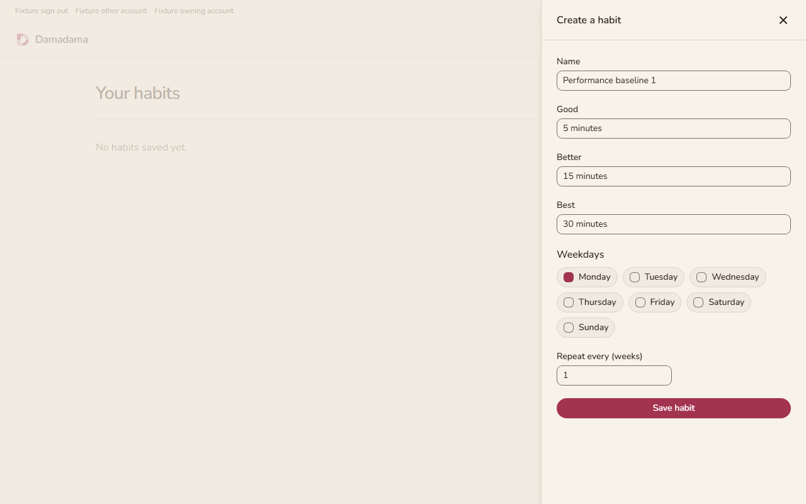
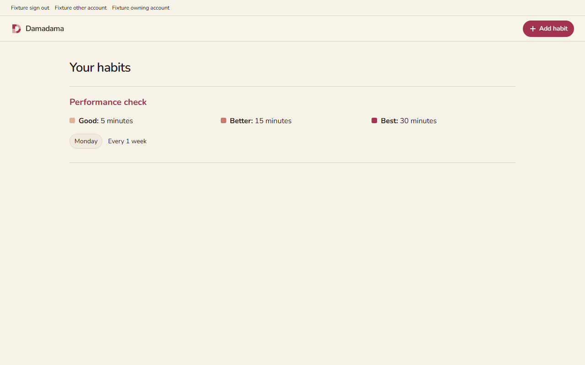

# Production performance gate evidence

The application baseline is PR11 at `9c8437e1e4a46965513b53f60d7fa569c0fd18ea`. This layer targets `feat/create-list-habits` because main does not contain the application. Merge PR11 first. Application markup, styles, authentication, and release workflows have no diff in this layer.

The unchanged production build totals 313,242 gzip bytes in seven assets. Five fresh-context browser runs used optimized actual habit components, the real API, ordinary JWT middleware, and ephemeral PostgreSQL. Every run saved a habit and verified persistence after reload, with 15 requests and zero recorded errors. Full conditions and fixed limits are in [the performance reference](../../../docs/browser-performance.md).

## Verification

[The final full check](performance-fix-check.log) passed five CLI controls, 12 browser tests, and 51 backend tests. The local command is `bun run check`. Reports stamped with the application base were produced before the implementation commit; the application source was unchanged. GitHub CI verifies the published revision separately.

[The initial oversized-JavaScript test](performance-red.log) failed with `Missing expected rejection` before budget enforcement. [The root-font test](performance-fix-cli-red.log) also failed before its guard; [the same real CLI control](performance-fix-root-font-after.log) then refused the uncounted font. The permanent CLI tests preserve both refusal cases.

The initial layout guard lost a [qualifying 0.303 shift](performance-fix-cls-observed-before.json) and [incorrectly passed](performance-fix-cls-before.json). The fixed guard [fails against 0.1](performance-fix-cls-red.log). Removing the mutation [passes](performance-fix-cls-green.json). These controls prove detection, not a speed improvement.

To reproduce the layout refusal on a disposable checkout, run `bun run check`, then `node .github/evidence/performance-ci/performance-fix-cls-control.mjs inject`. Run `node node_modules/@playwright/test/cli.js test --config tests/Browser/playwright.config.ts performance.spec.ts`; expect an exit code of one with a CLS value above 0.1. Restore with `node .github/evidence/performance-ci/performance-fix-cls-control.mjs remove` before formatting, then rerun `bun run check`.

## Independent reviews

Both thermo-nuclear passes approved the fixed executable snapshot. Their file hashes pin the source they read. Reports and media added for publication do not change that code.

- [Correctness and security, clean after both P2 fixes](performance-security-postfix.md).
- [Maintainability, clean after both P2 fixes](performance-quality-postfix.md), with [source hashes and details](performance-quality-postfix-details.md).
- Initial [security findings](performance-security-review.md) and [maintainability finding](performance-quality-review.md) remain visible.

The independent comment review passed with zero comments or suppressions requiring removal.

## Existing UI behavior

This CI change introduces no visual change. The screenshots and recording show the existing creation and saved-list behavior exercised by the new checks.

[Baseline create, save, and reload recording](baseline-flow.webm).

The deterministic fixture does not verify Clerk UI, email delivery, provider latency, or live production performance. Its reports contain no request headers, response bodies, or authentication tokens. Browser traces are disabled.
