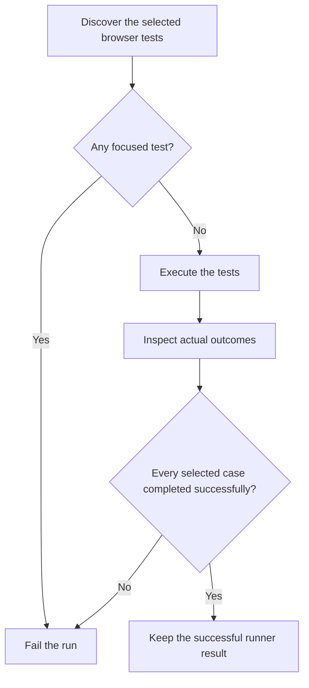

# Understanding the acceptance completeness check

## Start with the problem

Damadama has automated examples for important behavior, such as saving a habit and seeing it after a reload. A test runner executes those examples and reports its results.

A runner can succeed while some tests never run. A developer might temporarily select one test or mark a difficult test as skipped. This PR makes the normal acceptance commands reject those incomplete results.

For someone using the habit journal, this PR changes no screen or stored data. For a contributor, an incomplete automated acceptance run now stops the check and names the excluded test or invalid report.

## Learn the terms before reading the code

A focused test asks the runner to execute only a selected test or group. Playwright calls this `test.only` or `test.describe.only`.

A skipped test exists but does not execute its intended example. A skip can appear in the source or happen while the test runs.

An acceptance suite is the set of automated examples selected by a maintained test configuration. A complete result means those selected examples ran successfully. It does not prove the project contains every example it needs.

CI means the checks GitHub runs for a proposed revision. The local `bun run check` command runs the repository's authoritative checks before handoff.

## Follow the browser decision

Playwright first discovers its selected tests. The canonical browser configuration refuses focused tests. A completeness reporter then inspects the discovered tests and their actual outcomes.

The checks use this run's discovered tests. Adding a passing case does not require updating a historical expected count.

The maintained verification skill has its own selected journey list and JSON receipts. It must retain completeness enforcement when it replaces the canonical reporter list. A selected journey pass is evidence about those journeys, not proof of real Clerk email delivery.

## Follow the backend decision

The backend runner is `dotnet test`. It writes a TRX file, an XML document describing actual test results.

The check removes its own previous report before the runner starts. It reads the report produced by that invocation and rejects missing, malformed, empty, skipped, or inconsistent results.

The backend also produces fixture data consumed by two existing receiver checks. Those consumers must run immediately after the backend. The new report decision happens after both consumers, so their ordering and freshness rules stay intact.

The focused contributor backend command uses the same result rule. Running the smaller command cannot turn a skipped backend case into an accepted complete run.

## Read the implementation in this order

1. Read [the canonical browser configuration](../tests/Browser/playwright.config.ts). It shows where browser policy attaches.
2. Read [the browser reporter](../tests/Browser/acceptance-reporter.ts) and [its real-run probes](../scripts/acceptance-browser.test.ts). The probes run small passing and excluded cases through Playwright itself.
3. Read [the TRX validator](../scripts/acceptance-results.ts) and [its NUnit runner probes](../scripts/acceptance-native.test.ts). The probes establish how the pinned NUnit adapter reports excluded cases.
4. Read [the common check](../scripts/check.ts) and [the contributor commands](../scripts/developer.ts). They own execution and report lifetime.
5. Read [the verification configuration](../.agents/skills/verify/playwright.config.mjs). It keeps its JSON report and the completeness decision together.

The PR description links exact-revision output. Use that output to assess what actually passed. This guide explains the design and is not a test receipt.

At the lowest level, the TRX reader uses the pinned `saxes` XML parser. It refuses document type declarations, reads namespaced result elements, and checks that summary counters agree with the passing result records. It does not execute XML declarations or load external entities.

## Know the limits before approving

These checks can reject the excluded outcomes their runners report. They cannot detect a deleted test, a missing requirement, or an assertion that proves the wrong thing.

The separate browser compatibility suite currently uses project-specific selection. Its intentional project-routing skips are outside this canonical completeness policy. Manual provider verification also remains separate.

Review the real runner probes and the current-revision full check. An absent Docker engine blocks PostgreSQL and integrated browser proof locally. A blocked command is not a passing result. The PR must identify that boundary and link the supported Linux run.
