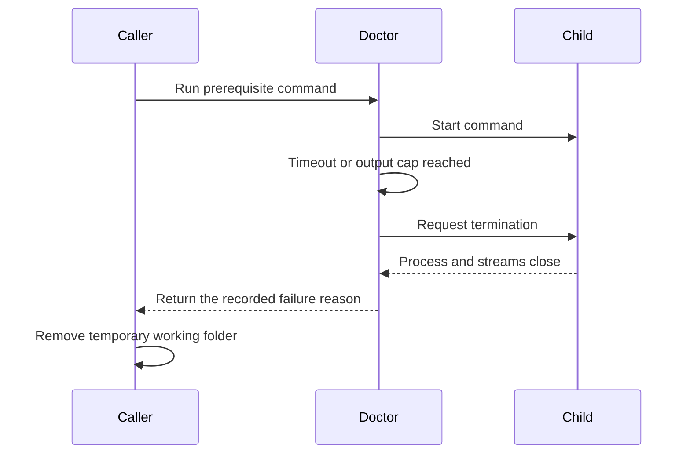

# Understanding prerequisite command cleanup

## Start with the problem

Before a contributor command builds or tests Damadama, the doctor checks its prerequisites. It runs short commands to ask Bun, .NET, and Docker whether they are available.

A command can hang or produce too much output. The doctor stops that command and reports the reason. On Windows, the old runner could report the result while the stopped process still held its working folder open. A caller that immediately removed its temporary folder could then fail with `EBUSY`, meaning the folder was still in use.

For a contributor, this repair makes cleanup reliable after the doctor stops a command. It changes no application screen or stored habit. The next maintainer gets a regression that runs a real process and removes its folder immediately after the result.

## Learn the terms

A child process is a separate program started by another program. The doctor starts each prerequisite command as a child.

A timeout limits how long the doctor waits. An output cap limits how many bytes the command may write. Both conditions request that the child stop.

A promise is the result the caller waits for. Resolving that promise tells the caller it may continue.

Node's `close` event means the child has ended and its input and output streams have closed. Requesting termination happens earlier. Those two moments cannot be treated as interchangeable.

## Follow the repaired sequence

The runner already records whether a timeout or output cap stopped the command. It also already has a `close` handler that returns that recorded result. The repair removes the earlier promise resolution from the stop helper, so the existing `close` handler owns completion.

The caller still receives the same failure category. It receives it after the child closes.

## Read the implementation in this order

1. Read `captureCommand` in [the doctor](../scripts/doctor.ts). Start with the result union, then the stop helper, then the `close` handler.
2. Read the real child-process cases in [the doctor tests](../scripts/doctor.test.ts). They cover timeout and output caps on both standard output and standard error.
3. Read [the contributor command runner](../scripts/developer.ts). It waits for prerequisite checks before preparing the application.
4. Read [the common check](../scripts/check.ts). It uses the same prerequisite boundary before the integrated checks.

At the lowest level, the production change deletes one call to `resolve` from the stop helper. It preserves the termination request, stream cleanup, result categories, and timeout and byte limits.

## Know what the proof establishes

The regressions start a real child that holds an isolated temporary folder as its working directory. After the command result arrives, the test immediately removes that folder. It does not insert a cleanup delay or retry.

Windows provides the meaningful folder-lock check. Linux permits removing many directories that a process still uses, so a Linux pass alone would not establish this Windows repair. The PR description links the tested revision and the Windows result.

The tests and implementation concern the directly spawned command. They do not introduce process-tree supervision or promise to terminate unrelated descendant programs.

## Read this before the acceptance PR

This is the parent of the acceptance completeness PR. That PR adds stricter test-result checks and exposed this existing command-lifetime defect during Windows verification. Review and merge this repair first, then review the acceptance layer against this branch. GitHub's native stack records that dependency.

Each PR has its own guide and evidence. This guide explains the repair. It is not a record of a particular test run.
