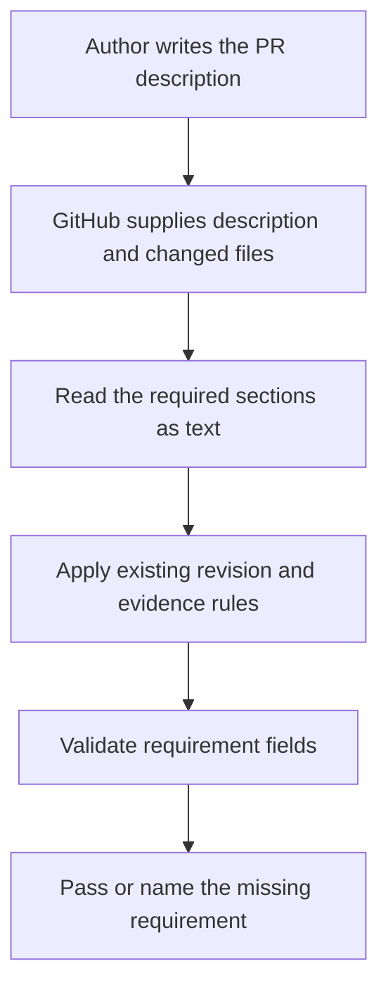

# Understanding the PR requirements check

## Start with the problem

A pull request proposes a change to Damadama. You review the proposal before anyone merges it into the shared `main` branch.

A passing test run tells you something about the code. It does not explain why the change exists. This PR requires the author to supply that explanation in a predictable place.

The author names one Notion story, states the outcome, describes the scope, gives acceptance examples, and records verification. The existing evidence rules still require proof for the current proposed revision.

For someone using the habit journal, this PR changes no screen or saved data. For a contributor, an incomplete description now fails the PR evidence check with instructions for the missing field.

## Understand what the check can establish

The new check reads the PR description. It can establish whether the required fields exist and whether the story URL has an accepted form.

It does not open Notion. It cannot establish whether the story exists, whether its examples are good, or whether every changed file serves one outcome. You still make those judgments during review. Trusted access to Notion would be a separate addition.

The distinction matters. An author can write a complete description that makes a weak argument. The check helps you find the argument. It does not approve the argument.

## Follow an example

The Requirements section contains a `Story:` line and an `Outcome:` line. For this PR, the story is [Require one outcome and a reviewable story per PR](https://app.notion.com/p/3f89c05101188180bbc4da6e38c3ce83).

A useful outcome says what changes for someone. For example, "Reviewers can find a change's requirement and acceptance examples before opening its code."

Scope explains what belongs to that outcome. Acceptance examples describe an initial condition, an action, and an expected result. Verification records what actually ran. Evidence links to the output and identifies the exact source revision.

If the story line is missing, adding a story link in an unrelated section does not fill the missing field. If the fields occur only inside a comment or a sample block, the description still needs its own real fields.

## Follow the information through GitHub

GitHub runs the existing PR evidence workflow when its caller handles a new PR, a changed revision, or a description edit. The application check remains a separate workflow.

The workflow has read-only access and does not check out the proposed code. It treats the description as text. Text that resembles a shell command or JavaScript stays text.

The new metadata rules run alongside the current checks for screenshots, recordings, tested revision, generated output, and proof links. A complete Requirements section cannot replace those checks.

## Read the code in this order

1. Read [the PR template](../.github/pull_request_template.md). It shows the form a contributor fills in.
2. Read [the workflow behavior tests](../scripts/pr-evidence.test.mjs). They give passing descriptions and then remove or corrupt one requirement at a time.
3. Read [the PR evidence workflow](../.github/workflows/pr-evidence.yml). Its inline script owns the actual policy.

The tests extract and execute that actual inline script. They do not maintain a second implementation of the policy. When the workflow changes, the behavior tests exercise the changed code.

At the lowest level, the script identifies section boundaries, reads the required fields, validates the story URL, and reports a useful failure. It must distinguish a real heading from a heading inside a code example. It must reject repeated fields rather than choosing whichever copy happens to be first.

## Decide whether the PR is ready

Read the final PR diff and the evidence linked in its description. Check that a missing requirement fails, a complete description passes, and the existing evidence refusals still work.

Then assess the substance. Does the outcome describe this change? Do the examples demonstrate the desired behavior? Does the linked output belong to the current revision? Do the files belong together?

The story stays partly unverified until trusted story-content validation exists. This PR delivers the description check. Human review remains responsible for the meaning of the description.
