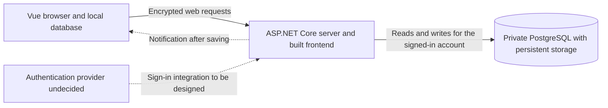

# Damadama system design

This design is a draft for review. The first feature still needs approval. [The requirements](requirements.md) describe the target behavior. This document proposes an implementation and lists the decisions to resolve before coding.

## User experience

A signed-in user creates a habit, defines its Good, Better, and Best tiers, and gives it a recurring schedule. On a scheduled date, they select Good, Better, Best, or Rest. They can change past entries. The heatmap uses the schedules that applied to those dates.

The browser stores each entry change on the device and shows it as pending. The server returns the winning value after its database transaction commits. Reconnect and app focus refresh saved data while preserving newer pending edits.

## System boundary

The ASP.NET Core app serves the built Vue frontend and handles database access. During local development, Vite can proxy server requests to ASP.NET Core. The authentication provider and session mechanism are undecided.

Keep ownership checks, habits, schedules, entries, and heatmap calculations in one backend project. Put pure recurrence and heatmap rules in small modules. Avoid service and repository classes that only forward persistence calls.

Entity Framework Core is a candidate for migrations and ordinary reads and writes. Entry conflict resolution needs an atomic PostgreSQL operation. Reading a row and then updating it through an object-relational mapper cannot enforce the rule if another writer changes the row between those operations. The persistence library remains a design choice.

## Proposed data model

| Concept | Data | Rule |
| --- | --- | --- |
| Account | Internal owner identity and authentication mapping | Decide the mapping when the authentication provider is selected. |
| Habit | Identifier, owner, name, and definitions for Good, Better, and Best | Derive the owner from server authentication. Do not trust an owner identifier supplied by the browser. |
| Schedule version | Habit, recurrence rule, and dates when the rule applies | Later edits must preserve past scheduled dates. Recurrence fields and version boundaries remain undecided. |
| Daily entry | Habit, calendar date, result, and edit time | Keep at most one row per habit per date. Store the winning timestamp and result. |
| Pending entry change | Account, habit, calendar date, result, original edit time, and local change identifier | Store it on the device separately from the saved entry. Retries keep the date and timestamp. |

Schedule versions preserve history. Decide effective dates and same-day edit behavior before designing their schema. A habit and calendar date identify an entry even after schedule edits.

The proposed schema uses PostgreSQL date columns for calendar dates and timestamp columns with time zones for edit times. The browser submits the selected date. The server never derives that date from the edit time or its own timezone. Agree on timestamp precision and normalization across the browser, .NET, and PostgreSQL before implementing conflict resolution.

Schedule writes and entry eligibility checks must agree when they run concurrently. Their transactions and locks depend on the schedule edit policy. Decide archiving and deletion behavior before implementing those operations. They must preserve the historical schedule data the heatmap needs.

## Entry save and reconciliation

1. At the user's selection, create a change with the account, habit, calendar date, result, and edit time. Record the edit time once for that action.
2. Store the change in an IndexedDB transaction. Wait for the transaction to complete before showing it as pending. Report a storage failure as a failed local save.
3. Send the change while authenticated as its owner. The backend validates the input, checks ownership, and checks whether the habit was scheduled on that date.
4. Use PostgreSQL's uniqueness constraint to keep one entry per habit per date. Compare the incoming timestamp and result atomically with the stored values. Replace the entry only if the incoming change wins.
5. Read the winning value in the transaction, including when the incoming change loses or repeats the stored value. Commit before acknowledging the server save.
6. After a changed entry commits, notify the owner's open connections. A failed notification cannot undo the save.
7. Reconcile the response with local state. Remove only the acknowledged change. Keep any later queued edit pending.

Compare the edit times first. For exact timestamp ties, prefer Best > Better > Good > Rest. A newer Rest beats an older Best. Identical timestamp and result pairs leave the entry unchanged. Request arrival order does not choose the winner.

Use a conditional PostgreSQL insert-or-update operation to compare and save the change atomically. If the comparison rejects the change, read the winning entry before committing. Do not assume a concurrent insert is visible to another read in the same database statement. See the [PostgreSQL insert documentation](https://www.postgresql.org/docs/18/sql-insert.html).

The proposed local change identifier matches a response to its queued change. It does not affect the server's conflict comparison. Delayed responses, refreshes, and notification-triggered reads must preserve later pending edits.

Keep the device queue scoped to the account. Multiple tabs must coordinate through that stored state and tolerate duplicate sends. Pause delivery when authentication expires. Decide what happens to pending changes on sign-out and how to display them after an account switch.

The pending queue stores entry changes, but it does not cache the app or its habits and schedules. Offline reopening needs those cached too. Decide whether offline reopening is required before implementing it. See the [IndexedDB transaction specification](https://w3c.github.io/IndexedDB/#transaction-finished).

## Heatmap calculation

For each date in the requested range:

1. Use historical schedules to find the owner's habits scheduled on that date.
2. Sum their entry points. Good earns 1, Better 2, Best 3, and Rest 0. Do not create a Rest entry for a missing selection.
3. Calculate the daily maximum as 3 times the scheduled habit count.
4. When the maximum is positive, divide earned points by that maximum to get opacity.

Two scheduled habits with Best and Rest earn 3 points out of 6, so opacity is 0.5. Rest stays in the denominator.

With no scheduled habits, the maximum is zero and the ratio is undefined. Keep that case separate from a scheduled day with zero points. Its appearance is undecided. The exact past-year range, including endpoints and leap years, also needs a decision.

Calculate the heatmap inside the backend. Do not add a separate service or query cache.

## Live updates

Use server-sent events that authenticate each connection and notify only the account that owns the data. Notifications are best effort while there is one app instance. The notification tells the browser to refetch. Subscribe and refetch in an order that avoids missing a change during connection setup. Refetch on reconnect and app focus while preserving pending edits.

Limit notification buffering for slow clients and combine notifications when needed. A disconnected client refetches saved data. Notifications need no durable replay. A server restart loses in-process notifications but leaves committed entries intact.

If replicas are introduced, review publish-and-subscribe messaging between app instances before enabling them. Measure the time between commit and a visible update against the approximate two-second target under normal conditions. No numeric target for server response times is agreed.

## Hosting, recovery, and cost

Railway is the proposed host. One app service runs the server and serves the built frontend. A separate PostgreSQL service has private access and persistent storage. Keep both services awake. Use encrypted web connections and server-side ownership checks.

The $10-15 monthly target covers the app, database, storage, backups, and any authentication or network costs. Railway bills resource usage, so measure actual usage before relying on that estimate. A spending control that stops workloads also causes downtime. It must not become an unapproved spending cap. See [Railway pricing](https://docs.railway.com/pricing/plans) and [cost controls](https://docs.railway.com/pricing/cost-control).

Persistent storage does not replace backups or restore tests. Railway supports volume backups, but wiping a volume deletes its backups. Restores are limited to the same project and environment. Before production, agree on backup frequency, retention, acceptable data loss, and recovery time. Restore into an isolated test target and check the records. See [Railway backups](https://docs.railway.com/volumes/backups).

Document repeatable local startup, migrations, example configuration, and deployment commands. Commit no secrets. Deployment instructions do not approve provisioning, deployment, or domain name settings changes.

## Verification plan

| Area | Evidence required before review |
| --- | --- |
| Ownership | Web request tests with real PostgreSQL prove that a second account cannot read or change another owner's habits, schedules, entries, or heatmap, or receive that owner's notification data. |
| Habits | Browser and database tests cover creation, listing, persistence, and tier definitions. Decide whether creation requires a schedule before writing the contract. |
| Schedules | Domain tests cover the agreed recurrence rules and interval anchors. Integration tests preserve past scheduled dates across edits, including the agreed same-day policy. |
| Entries | Domain tests and concurrent PostgreSQL tests cover uniqueness, newest timestamps, every timestamp tie, identical retries, and responses to losing writes. |
| Heatmap | Domain tests prove that Rest stays in the denominator and calculations use historical schedules. Test the range and zero-schedule display after those decisions. |
| Local dates | Browser tests cover timezone travel and date boundaries. Retries preserve the calendar date and original edit time. |
| Offline recovery | Browser tests queue changes offline, survive reload, reconnect, and reconcile. Test a lost response after commit and an older response arriving after a newer edit. Offline reopening needs a scope decision. |
| Live updates | Two authenticated browser contexts test update delay, ownership isolation, reconnect, app focus, and recovery after a server restart. |
| Recovery | Restore a backup into an isolated target and verify saved records. Current work excludes production restores and paid provisioning. |
| Reproducibility | A clean checkout starts with documented commands. Domain, PostgreSQL, browser, type, and build checks can be repeated. |

## Proposed delivery sequence

Explain each story before coding it. After implementation, show tests and runtime evidence and stop for review. Each story needs its own approval.

1. Let signed-in users create and list their own habits with tier definitions. Include repeatable local startup. Decide authentication and whether creation requires a schedule first. A local stack prototype remains an option if the user chooses it.
2. Create and revise schedules without changing past scheduled dates. Decide recurrence rules and when edits take effect first.
3. Save and revise entries for scheduled dates with atomic PostgreSQL conflict resolution.
4. Show the combined heatmap using historical schedules. Decide the date range and appearance of days with no scheduled habits first.
5. Store and retry pending entry changes. Decide offline scope, expired authentication, sign-out, and permanent-error display first.
6. Notify the owner's other devices and refresh on reconnect or app focus.
7. Write and test recovery and deployment procedures. Paid provisioning and deployment need separate approval.

The first story still needs a scope decision and implementation approval. The [tracking guide](project-management.md) links the issues and review workflow.

## Unresolved decisions

Resolve these product questions before implementing the affected behavior:

- Exact recurrence options and representation, including interval anchors.
- When schedule edits take effect and which edit wins if several happen on one day.
- How to display a day with no scheduled habits.
- The authentication provider and session mechanism.
- Habit editing, archiving, and deletion behavior.

Review also raised these questions:

- Must a new habit include a schedule, or can it remain unscheduled?
- Does editing a tier definition change its meaning for past entries?
- What dates does "past year" include, and does it include Today?
- Can users select future scheduled dates or clear an entry?
- Must the app reopen and allow editing while offline, or is retrying stored entry changes enough?
- What happens to pending account data on sign-out, and how should permanent rejections appear?
- What backup retention, acceptable data loss, and recovery time are required?

Numeric targets for server response times, hard spending caps, offline edits to habits or schedules, and replica infrastructure are not agreed requirements.
