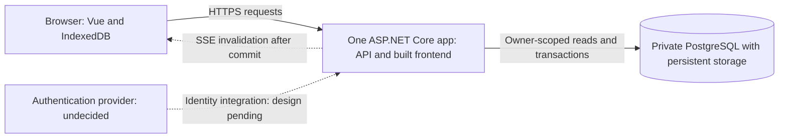

# Damadama system design

Status: draft for review. No application code exists. The [user-supplied requirements](requirements.md) define the target behavior; this document proposes how to realize it. Product decisions marked unresolved are implementation gates, not defaults.

This design supersedes the earlier single-user, ID/name-only proposal. The first code slice has not been approved.

## User experience

A signed-in person creates a habit, defines its Good, Better, and Best tiers, and gives it a recurring schedule. On a scheduled date they select Good, Better, Best, or Rest. Past scheduled dates remain editable. The combined heatmap uses the schedules applicable to those historical dates.

An entry change is first persisted on the device and shown as pending. The server confirms its winning value after a database commit. Reconnect and app focus refresh committed data without silently discarding newer pending edits.

## System boundary

Vue is built into static assets served by the app in the proposed hosted setup. During local development, Vite can proxy API requests to ASP.NET Core. Database access belongs to the server. Authentication provider and session mechanism remain undecided.

The one backend contains account/ownership handling, habits, schedules, entries, and heatmap calculation. These are areas within one backend project, not independent services. Pure recurrence and heatmap calculations warrant small domain modules because they own real rules. Avoid pass-through service and repository layers that only repeat persistence methods.

EF Core migrations remain a candidate for schema management and ordinary persistence. Entry conflict resolution needs a PostgreSQL operation that implements the atomic comparison; an ORM read followed by a normal update cannot establish that invariant. Persistence library details are proposals, not product requirements.

## Proposed data model

| Concept | Data and responsibility | Invariant |
| --- | --- | --- |
| Account | Internal owner identity and authentication mapping | Provider identity mapping remains to be designed when the provider is selected. |
| Habit | ID, owner, name, Good/Better/Best definitions | Ownership is established from server authentication, not a trusted owner ID in a request. |
| Schedule version | Habit and historical recurrence rule with calendar-date applicability | Editing a schedule cannot rewrite which habits were scheduled on past dates. Recurrence fields and version boundaries remain unresolved. |
| Daily entry | Habit, calendar date, result, loggedAt | At most one row per habit/date. Its value is the winning timestamp/result pair. |
| Pending entry change | Originating account, habit, calendar date, result, original loggedAt, local mutation identity | Durable device state separate from the server's saved entry. Retry preserves date and timestamp. |

Schedule versions are the recommended representation of history. The schema for effective dates and same-day revisions must wait for the product rule. Entry identity remains habit/date even when schedules change.

Propose PostgreSQL `date` for calendar dates and `timestamptz` for edit instants. A browser submits the selected calendar date explicitly. The server does not derive that date from loggedAt or its own timezone. Timestamp precision and normalization must be fixed across browser, .NET, and PostgreSQL before conflict handling is implemented.

Schedule writes and entry eligibility checks must also remain consistent under concurrency. Their transaction and locking strategy depends on the schedule edit rule. Habit lifecycle changes cannot silently remove the historical schedule data needed by the heatmap; archive/delete semantics are still unresolved.

## Entry save and reconciliation

1. Determine the selected habit/date and originating account. Create the entry change's loggedAt once at the user's action.
2. Persist the mutation in an IndexedDB transaction. Treat transaction completion as local durability and show pending state. A persistence failure cannot be shown as a successful local save.
3. Send the mutation while authenticated as its originating owner. The backend authenticates, validates input, and checks ownership and historical schedule eligibility.
4. In PostgreSQL, use the habit/date uniqueness constraint and atomically accept an incoming pair only when it is greater than the stored pair.
5. Read the authoritative winner within the transaction, including when the incoming change loses or is an identical retry. Commit before acknowledging a server save.
6. Publish an owner-scoped in-process invalidation after a changed value commits. Notification failure cannot undo or invalidate a committed save.
7. Reconcile the returned winner with local state. Remove only the acknowledged local mutation. If a later edit has been queued, it remains pending.

The comparison is lexicographic: compare loggedAt first; if equal, compare Best > Better > Good > Rest. A newer Rest wins over an older Best. Equal timestamp/result pairs leave the stored value unchanged. This is last-edit-wins according to device timestamps, not highest-result-wins or latest-request-arrival-wins.

PostgreSQL supports an atomic `INSERT ... ON CONFLICT DO UPDATE` with a conditional comparison. Its `RETURNING` clause yields no row for a conditional no-op, so the operation must explicitly obtain the winner for that path. A same-statement fallback must not assume a concurrently inserted row is visible. [PostgreSQL INSERT documentation](https://www.postgresql.org/docs/18/sql-insert.html).

The local mutation identity is proposed bookkeeping for matching responses. It does not replace the specified server conflict comparison. Delayed responses, refreshes, and SSE-triggered reads must not erase later pending edits. Multiple tabs must coordinate through durable account-scoped state and tolerate duplicate sends. Auth expiry pauses delivery; sign-out retention and account-switch presentation require product decisions before those flows are implemented.

IndexedDB persistence protects queued data, but does not by itself cache the app shell or habits/schedules for reopening while offline. That broader offline scope remains unresolved. [IndexedDB transaction specification](https://w3c.github.io/IndexedDB/#transaction-finished).

## Heatmap calculation

For each date in the requested range:

1. Use historical schedules to find the owner's habits scheduled on that date.
2. Sum those habits' entry points: Good 1, Better 2, Best 3, Rest 0. An absent entry is not converted into a Rest row.
3. Compute daily maximum as 3 times scheduled habit count.
4. For a positive maximum, return points earned divided by daily maximum.

For example, two scheduled habits with Best and Rest yield 3 points out of 6, so opacity is 0.5. Rest does not shrink the denominator.

With no scheduled habits, the maximum is zero and the ordinary ratio is undefined. Represent that condition separately from a scheduled day with zero points. Its appearance is unresolved. The exact meaning of past year, including endpoints and leap years, also remains unresolved. Heatmap calculation stays inside the backend, with no separate service or query cache.

## Live updates

Use authenticated, owner-scoped SSE connections for best-effort invalidations while there is one app instance. Subscribe and refetch so connection establishment does not leave a missed-update gap. Reconnect and focus refetch authoritative saved state while preserving local pending mutations.

Bound slow-client notification buffering and coalesce invalidations when needed. A disconnected client refetches; it does not depend on durable notification replay. The database remains the saved record. A restart loses in-process notifications, not committed entries. If replicas are introduced, revisit cross-instance pub/sub before enabling them.

Measure commit-to-visible-update delay against the approximate two-second normal-condition target. There is no agreed numeric API latency target.

## Hosting, recovery, and cost

Railway is a proposed deployment target. One app service serves API and built frontend; PostgreSQL is a separate database service with persistent storage and private access. Avoid intentional idle sleeping for both services. HTTPS and server ownership checks remain required.

Railway bills resource usage; the $10-15 target includes app, database, storage, backups, and any auth or network costs. It remains an estimate until resources are measured. Spending controls that stop workloads would trade availability for cost containment, so they cannot silently redefine the stated target. [Railway pricing](https://docs.railway.com/pricing/plans), [cost controls](https://docs.railway.com/pricing/cost-control).

Persistent storage, backup scheduling, and restore verification are separate requirements. Railway supports volume backups, but wiping a volume deletes its backups and restores are limited to the same project/environment. Backup frequency, retention, acceptable data loss, and recovery time need a recovery design before production. Verify restoration into an isolated test target and check actual records. [Railway backups](https://docs.railway.com/volumes/backups).

Local startup, migrations, example configuration, and later deployment instructions must be reproducible without committed secrets. A deployment runbook does not authorize provisioning, deployment, or DNS changes.

## Verification plan

| Area | Required evidence before its slice is complete |
| --- | --- |
| Ownership | Real HTTP/PostgreSQL tests prove a second account cannot read or alter another owner's habits, schedules, entries, heatmap, or receive its notification data. |
| Habits | Browser create/list and database persistence tests include Good/Better/Best definitions. Exact creation contract waits for schedule attachment decisions. |
| Schedules | Domain tests cover the agreed recurrence options and interval anchors; integration tests preserve historical scheduled dates across edits, including the agreed same-day policy. |
| Entries | Domain and concurrent PostgreSQL tests cover one row per habit/date, newest timestamp, all exact-timestamp ties, identical retries, and authoritative losing-write responses. |
| Heatmap | Domain tests prove the denominator includes Rest and uses historical schedules. Range and zero-schedule display tests follow the product decisions. |
| Local dates | Browser tests cover timezone travel, date boundaries, and retries retaining the original calendar date and loggedAt. |
| Offline recovery | Browser tests queue while offline, survive reload, reconnect, and reconcile. Simulate a lost response after commit and a delayed response arriving after a newer local edit. Broader offline reopening waits for scope approval. |
| Live updates | Two authenticated browser contexts verify update delay, ownership isolation, disconnect/reconnect, focus refresh, and recovery after server restart. |
| Recovery | Restore a backup into an isolated target and verify saved records. No production restore or paid provisioning is part of current work. |
| Reproducibility | A clean checkout starts locally with documented commands; domain, PostgreSQL, browser, type-checking, and build checks are repeatable. |

## Proposed delivery sequence

Each code slice needs a design explanation before implementation, tests and runtime evidence afterward, and a review stop. These are outcome groups, not approval to implement them together.

1. Account-owned habit create/list with Good/Better/Best definitions and repeatable local startup. Requires provider/session choice and a decision on whether habit creation must attach a schedule. A local stack prototype remains an alternative only if explicitly chosen.
2. Create and revise schedules while preserving historical scheduled dates. Requires recurrence and edit-effectiveness decisions.
3. Record and revise scheduled-date entries with atomic PostgreSQL conflict handling.
4. Show the combined heatmap based on historical schedules. Requires range and no-scheduled-habits presentation decisions.
5. Persist and replay pending entry changes with safe reconciliation. Requires offline scope, auth-expiry/sign-out behavior, and permanent-error presentation decisions.
6. Add owner-scoped live invalidation and reconnect/focus recovery.
7. Write and verify recovery and deployment procedures. Any paid provisioning or deployment needs separate authorization.

The exact first slice is awaiting the user's selection and implementation approval. The user has authorized documentation and project tracking in `ShiosOS/Damadama`. See [project management](README.md) for the tracker and review workflow. Creating a task does not approve its implementation.

## Unresolved decisions

The user's explicit gates:

- Exact recurrence options and representation, including interval anchors.
- Schedule edit effective dates and precedence for multiple edits on one day.
- Appearance of a day with no scheduled habits.
- Authentication provider and resulting session integration.
- Habit editing, archiving, and deletion behavior.

Additional questions surfaced by review, to resolve when their slices are designed:

- Must a new habit include a schedule, or may it remain unscheduled?
- Does editing a tier definition change its interpretation on past entries?
- What exact date range does past year mean, and does it include Today?
- Are future scheduled-date selections or clearing an entry supported?
- Must the app reopen and permit editing while still offline, or is durable pending entry delivery sufficient?
- What happens to pending account data on sign-out, and how are permanent rejections presented?
- What backup retention, acceptable data loss, and recovery time are required?

Numeric API latency, absolute spending caps, offline habit/schedule edits, and replica infrastructure are not agreed requirements.

## Design rationale

Redesign From First Principles replaces the earlier name-only model with ownership, tier definitions, historical schedules, and fixed-date entries as foundational assumptions. Model the Domain gives schedule history, saved entries, and pending changes separate representations. Boundary Discipline locates authentication and validation at requests and the atomic winner comparison at PostgreSQL. Make Operations Idempotent keeps a retry's date/timestamp unchanged and makes duplicate delivery converge. Sequence Work into Verifiable Units keeps the work reviewable one slice at a time.
